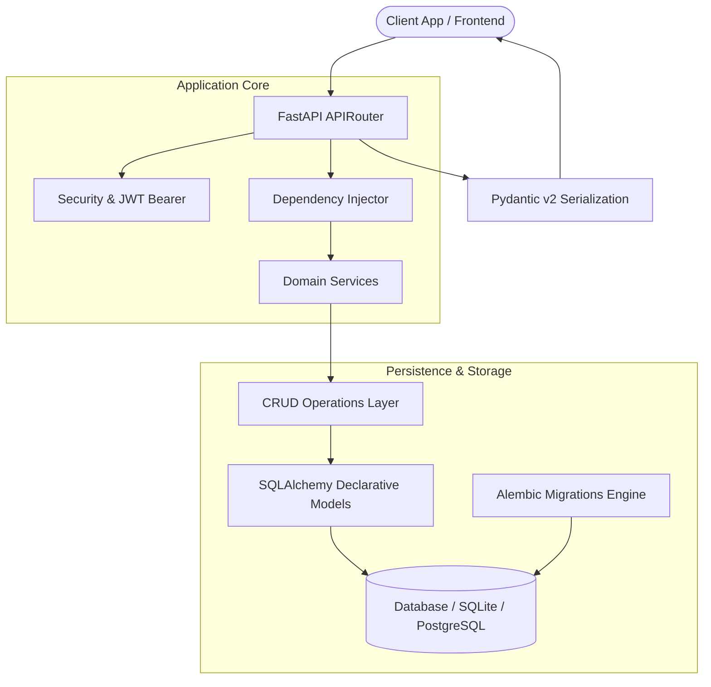

<div align="center">

# 🏦 NeoFi Backend — Asynchronous Financial Services API

**A production-grade, asynchronous backend architecture built with FastAPI, SQLAlchemy ORM, Alembic migrations, and Pydantic validation for high-throughput financial workflows.**

[](https://fastapi.tiangolo.com)
[](https://python.org)
[](https://www.sqlalchemy.org/)
[](https://alembic.sqlalchemy.org/)
[](LICENSE)

[Architecture](#-system-architecture) • [Key Capabilities](#-key-capabilities) • [Directory Structure](#-directory-structure) • [Quickstart](#-quickstart-guide) • [API Documentation](#-api-documentation)

</div>

---

## 💡 Overview

**NeoFi Backend** provides a clean, modular microservice architecture designed for modern fintech and neo-banking operations. Built with **FastAPI**, it leverages asynchronous request handling, strictly typed Pydantic data contracts, and reproducible database schema migrations via **Alembic**.

---

## 🏗️ System Architecture



---

## ✨ Key Capabilities

- **⚡ Asynchronous Core**: High-concurrency async endpoints utilizing `Uvicorn` and ASGI standards.
- **🧱 Clean Layered Architecture**: Strict segregation between Routing (`api/`), Business Logic (`services/`), and Database Access (`crud/` & `models/`).
- **🔄 Declarative Database Migrations**: Integrated Alembic tracking schema evolutions with zero downtime.
- **🛡️ Type Safety & Schema Validation**: Pydantic models for incoming payload validation and outgoing response serialization.
- **📖 Auto-Generated Interactive Docs**: Out-of-the-box Swagger UI (`/docs`) and ReDoc (`/redoc`) API explorers.

---

## 📁 Directory Structure

```bash
neofi_backend/
├── run.py                     # Entry point runner script
├── LICENSE                    # MIT License
├── README.md                  # Comprehensive architectural documentation
└── neofi_backend/
    ├── alembic.ini            # Alembic configuration
    ├── requirements.txt       # Production dependencies
    ├── alembic/               # Database revision migration scripts
    └── app/
        ├── main.py            # FastAPI application factory
        ├── dependencies.py    # Request dependency injection (DB sessions, auth)
        ├── api/               # API route definitions
        ├── core/              # Config, settings, and security helpers
        ├── crud/              # Database read/write primitives
        ├── db/                # Engine initialization & session makers
        ├── models/            # SQLAlchemy declarative ORM models
        ├── schemas/           # Pydantic request/response schemas
        └── services/          # Business domain services
```

---

## 🚀 Quickstart Guide

### 1. Clone the Repository
```bash
git clone https://github.com/deekshi07/neofi_backend.git
cd neofi_backend
```

### 2. Set Up Virtual Environment
```bash
python -m venv venv

# macOS / Linux
source venv/bin/activate

# Windows (PowerShell)
.\venv\Scripts\activate
```

### 3. Install Dependencies
```bash
pip install -r neofi_backend/requirements.txt
```

### 4. Run Database Migrations
```bash
cd neofi_backend
alembic upgrade head
cd ..
```

### 5. Launch the Server
```bash
python run.py
```
Open **[http://localhost:8000/docs](http://localhost:8000/docs)** to test the interactive Swagger API documentation.

---

## 📄 License

This project is licensed under the [MIT License](LICENSE).
